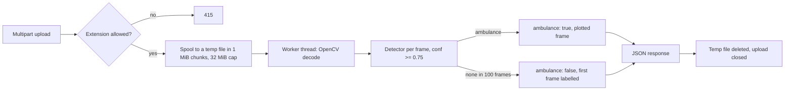

# Ambulance-priority video API

A FastAPI backend that takes an uploaded traffic video, scans up to 100 decoded frames for an `ambulance` detection and returns a yes/no flag, the confidence and a JPEG preview of the frame it decided on. It is the detection half of an ambulance-priority traffic signal idea: a signal controller would call it and give the ambulance's approach a green.

What is here is the backend only. **The React dashboard, the trained ambulance weights, the training data and any traffic-signal integration are not in this repository.** Without weights the API runs in a clearly labelled simulation mode, which exercises the upload, decode and response path but does not recognise anything.

## Run it with Docker

The image runs simulation mode and contains no model code or weights:

```sh
cd smart-traffic-backend
docker build -t ambulance-priority-api .
docker run --rm -p 8000:8000 ambulance-priority-api
```

In another terminal, from the repository root:

```sh
curl http://127.0.0.1:8000/health
curl -F file=@smart-traffic-backend/samples/synthetic-traffic.avi http://127.0.0.1:8000/predict
```

To pass settings, copy `.env.example` to `.env` and add `--env-file ../.env` to `docker run`.

## Run it with Python

Python 3.12 is pinned in `.python-version`.

```sh
cd smart-traffic-backend
python3.12 -m venv .venv
source .venv/bin/activate
python -m pip install -r requirements.txt
ITCS_USE_DUMMY_MODEL=1 uvicorn main:app --host 127.0.0.1 --port 8000
```

Simulation mode never imports Ultralytics, loads a checkpoint or downloads weights.

## API

| Method | Path | Purpose |
| --- | --- | --- |
| `GET` | `/health` | Liveness and which detector is loaded (`simulation` or `model`) |
| `POST` | `/predict` | Multipart upload in the `file` field; scans the video and returns the result |

These exchanges were captured from the Docker image above.

```
$ curl -i http://127.0.0.1:8000/health
HTTP/1.1 200 OK
content-type: application/json

{"status":"ok","mode":"simulation"}
```

```
$ curl -F file=@smart-traffic-backend/samples/synthetic-traffic.avi http://127.0.0.1:8000/predict
HTTP/1.1 200 OK
content-type: application/json

{"ambulance":true,"frame":"/9j/4AAQSkZJRgABAQAAAQAB...","confidence":0.9,"mode":"simulation","frames_examined":1}
```

`frame` is a base64 JPEG (about 7 KB for the sample clip), shortened here. In simulation mode the dummy detector reports an ambulance on the first frame of any decodable video, so this response says nothing about the clip's content.

Errors use FastAPI's `{"detail": ...}` shape:

| Status | When | `detail` |
| --- | --- | --- |
| 415 | Filename extension is not `.mp4`, `.avi`, `.mov`, `.mkv` or `.webm` | `Use a supported video filename` |
| 413 | Upload larger than 32 MiB | `Video must be at most 32 MiB` |
| 413 | A decoded frame has more pixels than 3840x2160 | `Frame exceeds 4K pixel limit` |
| 422 | OpenCV cannot open the file, e.g. random bytes named `.mp4` | `Video could not be decoded` |
| 422 | The file opens but yields no frames | `Video contains no decodable frames` |
| 500 | Anything else, such as a failed JPEG encode (logged with a traceback) | `Failed to process video.` |

## Sample videos

`smart-traffic-backend/samples/synthetic-traffic.avi` is a 45 KB, 12-frame clip of drawn shapes: a road, lane markings, a white van with a red cross and a blue car. It has no real footage, people or number plates. Regenerate it, or make a longer one, with:

```sh
cd smart-traffic-backend
python scripts/make_synthetic_clip.py samples/synthetic-traffic.avi --frames 12
```

The original project shipped two real dashcam-style clips of about 24 MB and 25 MB in `test_files/`. They are deliberately not tracked by git (`test_files/` is in `.gitignore`), because of their size and because real street footage can show people and number plates. To test with real video, put your own clip in `test_files/` or anywhere else and upload it the same way. It must be 32 MiB or smaller and use one of the extensions above. Only the first 100 frames are examined.

## Model-backed mode

This path needs artifacts that are not part of the repository:

1. Install the model requirements. They add Ultralytics and, through it, PyTorch. On machines without a GPU, the CPU-only wheels are much smaller:

   ```sh
   python -m pip install --extra-index-url https://download.pytorch.org/whl/cpu -r requirements-model.txt
   ```

2. Put reviewed, trusted YOLO weights at `smart-traffic-backend/weights/best.pt`. The model's class names must include `ambulance`. Startup fails if the file is missing or no class has that name. No other class is ever relabelled as an ambulance.
3. Start uvicorn without `ITCS_USE_DUMMY_MODEL`. `/health` then reports `"mode":"model"`.

Weights are never committed (`weights/` and `*.pt` are ignored), and nothing in the project downloads them. The training procedure, dataset and evaluation metrics for the original `best.pt` are not available, so this repository makes no accuracy claim. The model path has not been exercised in this repository's automated checks. Only simulation mode and the stubbed detector are tested.

## Configuration

| Variable | Default | Effect |
| --- | --- | --- |
| `ITCS_USE_DUMMY_MODEL` | unset (model mode) | `1` loads the dummy detector instead of `weights/best.pt`. The Docker image sets it to `1` |
| `ITCS_CORS_ORIGINS` | `*` | Comma-separated list of browser origins allowed to call the API |

## How a request is processed



Design choices worth knowing:

- **Decoding and inference run on a worker thread** (`run_in_threadpool`), so one long upload does not freeze `/health` or other requests. Only the upload copy itself is async.
- **The scan stops at the first qualifying box** (class `ambulance`, confidence of at least 0.75). It does not keep looking for a better frame. A negative answer means "nothing found in the examined frames", not "no ambulance in this video".
- **Hard limits instead of trust:** a 32 MiB upload cap enforced while streaming, a 4K per-frame pixel cap, a 100-frame cap and an extension allow-list. The temp file is removed on every path, including rejected uploads.
- **Simulation is explicit.** Every response carries `mode`, so a simulated "ambulance: true" cannot be mistaken for a model result. An earlier version had a filename-based debug shortcut, and anything named `ambulance.mp4` was flagged. It was removed, and a test guards against it coming back.

## Tests and lint

```sh
cd smart-traffic-backend
python -m pip install -r requirements-dev.txt
python -m pytest -q
ruff check . && ruff format --check .
```

The 18 tests need no network or weights. Most replace `cv2.VideoCapture` with an in-memory frame list to cover the positive and negative paths, the 100-frame cap, the 4K and 32 MiB limits, the absence of class remapping, temp-file cleanup, a failed JPEG encode and the CORS settings. One test checks that inference never runs on the event loop thread. Others decode real MJPG clips drawn by `scripts/make_synthetic_clip.py`.

## Before hosting this

It is a prototype. It has no authentication or rate limiting. Concurrency is bounded only by the thread pool, and a request has no overall deadline. Model confidence is not a calibrated probability, and there are no verified camera, signal-controller or frontend integrations. A meaningful next step on the ML side would be a reproducible held-out evaluation with false-positive and false-negative examples and measured latency.

## Licence

The code in this repository is MIT-licensed (see `LICENSE`).

The optional model path depends on [Ultralytics](https://github.com/ultralytics/ultralytics), which is licensed under **AGPL-3.0**. Simulation mode and the Docker image do not install or import it. If you install `requirements-model.txt` and offer the service to others over a network, the AGPL's terms apply to that combined deployment, unless you hold an Ultralytics Enterprise licence. Any weights you supply carry their own licence.
