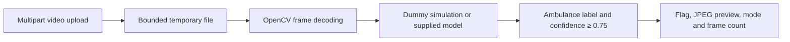

# Emergency-vehicle video API prototype

A FastAPI experiment that examines up to 100 decoded video frames and returns an ambulance flag, confidence and a JPEG preview. The repository contains the backend and two sample videos. **The advertised React dashboard, trained weights, training data and traffic-signal integration are not included.**

The executable demo is a clearly labeled simulation. It does not operate traffic lights, establish detection accuracy or provide emergency-response guarantees.

## Run the simulation without model weights

Use Python 3.11+:

```sh
cd smart-traffic-backend
python3 -m venv .venv
source .venv/bin/activate
python -m pip install -r requirements-demo.txt
ITCS_USE_DUMMY_MODEL=1 uvicorn main:app --host 127.0.0.1 --port 8000
```

`GET /health` returns `{"status":"ok","mode":"simulation"}`. The dummy model reports a positive detection on the first decoded frame regardless of video content; it exists to demonstrate the API/preview path, not to test recognition. Simulation mode does not import Ultralytics, load a checkpoint or download weights.

```sh
curl -F 'file=@/path/to/synthetic-video.mp4' http://127.0.0.1:8000/predict
```

A synthetic positive response has this shape:

```json
{
  "ambulance":true,
  "frame":"<base64 JPEG omitted>",
  "confidence":0.9,
  "mode":"simulation",
  "frames_examined":1
}
```

The two existing videos are retained as project assets; their presence is not evaluation evidence, and no frames from them were published as new screenshots.

## Model-backed path requires separate artifacts

Install `smart-traffic-backend/requirements.txt` only when intentionally setting up the model environment. Supply reviewed, trusted weights at `smart-traffic-backend/weights/best.pt`, then run without the dummy-mode variable. Missing weights fail startup instead of silently substituting a detector. Model metadata must explicitly include an `ambulance` class; class zero is no longer unconditionally relabeled as an ambulance.

The weights, training procedure, dataset provenance and evaluation metrics are absent. No checkpoint was downloaded or loaded during this review. Review model-artifact trust and licensing separately before using third-party weights.

## Processing boundary



The endpoint accepts MP4/AVI/MOV/MKV/WebM filename extensions, up to 32 MiB. OpenCV must actually decode frames: unreadable/empty videos return 422, unsupported extensions 415, oversized uploads/frames 413. Frames larger than 4K pixel count are rejected after decoding. Uploads are copied in chunks, temporary files are removed and the upload is closed after processing.

Processing stops on the first qualifying ambulance box or after 100 frames. A negative response means no qualifying detection in those examined frames, not proof that the full video contains no ambulance. The former filename-based debug shortcut was removed; filenames cannot force positive detection. Model confidence is not a calibrated probability of real-world safety.

## Verification and remaining work

```sh
cd smart-traffic-backend
ITCS_USE_DUMMY_MODEL=1 python -m pytest -q
```

Eight tests pass using synthetic NumPy frames and a dummy capture/model: health and simulation labels, positive/negative paths, invalid/empty uploads, the 100-frame cap, no filename-based override, no class-zero remapping, and oversized-upload temporary-file cleanup. OpenCV was installed as a wheel for these tests; Ultralytics and model weights were not installed or executed. A TestClient deprecation warning remains in the verification environment.

Before hosting, add authentication, origin restrictions, bounded concurrent processing, worker isolation and request deadlines. Inference currently runs inside an async request and can block the event loop; byte/frame caps alone do not bound decode/inference cost. There are no verified live-camera, signal-controller or frontend integrations. A meaningful ML addition would be a reproducible held-out evaluation with false-positive/false-negative examples and measured latency, rather than an unsupported accuracy claim. No LICENSE file is present, so the old README's MIT-license claim has been removed.
